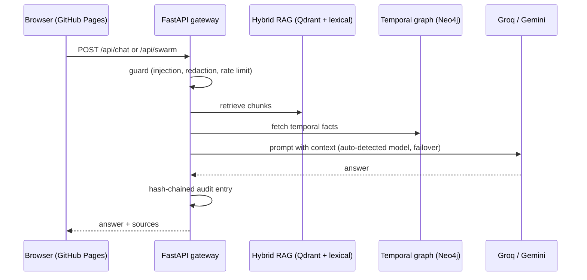

# Architecture

## Design decisions
- Static frontend on GitHub Pages; stateful services behind one API so keys stay server-side.
- Provider failover: Groq for short/fast, Gemini for long inputs; either covers the other.
- Retrieval degrades gracefully: Qdrant and Neo4j fall back to in-memory when not configured.
- The swarm is a LangGraph pipeline (sequential fallback) ending in an LLM judge score used as a feedback signal.
